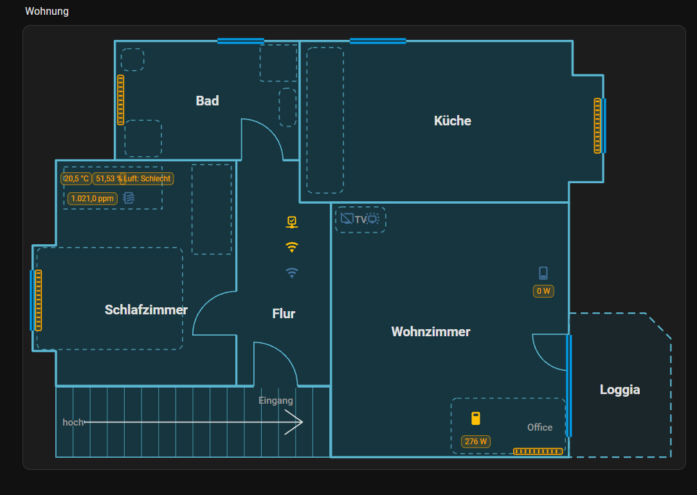

# Floorplan Card

A Lovelace card for Home Assistant that draws a floor plan from plain coordinates – rooms, windows, doors,
radiators and stairs – and colors them by entity state. It comes with a visual editor, so you can draw the
plan right in the dashboard: no SVG editor, no image, no YAML needed.



*Deutsch: [siehe unten](#deutsch).*

## Features

- Rooms as rectangles, polygons or circles/ellipses, with rounded corners and arc walls
- Windows colored by their contact sensor (open: red and pulsing, closed: green)
- Doors with swing, radiators showing when they heat, stairs with direction
- Icons and values of any entity on the plan, labels
- Link a room to a Home Assistant area: a click shows the area's devices in a popup (switch lights, see readings)
- Choose per room what a click does: nothing, entity details, open a dashboard or show the area
- Click a window or radiator for its details
- Colors follow your Home Assistant theme
- Visual editor with a CAD-like ribbon: grid, ortho and wall snap, undo, zoom, full screen
- Trace a template: upload a photo or scan of your floor plan, set its scale with two points and draw on top

## Installation

1. Copy `floorplan-card.js` to `/config/www/floorplan-card/`.
2. Add it as a dashboard resource: *Settings → Dashboards → ⋮ → Resources*,
   URL `/local/floorplan-card/floorplan-card.js`, type *JavaScript module*.
3. Add a card, search for *Floorplan Card* and start drawing.

## Example

Coordinates can be in any unit (meters, centimeters, pixels of a photo).

```yaml
type: custom:floorplan-card
rooms:
  - name: Living room
    rect: [0, 0, 5, 4]
    radii: [0.5, 0, 0, 0]
    navigation_path: /dashboard-home/living-room
  - area: kitchen            # name and click popup come from the Home Assistant area
    rect: [5, 0, 8, 4]
    arcs: [0, 0.8, 0, 0]
  - name: Bay
    ellipse: [1, 4, 3, 5.5]
windows:
  - from: [1, 0]
    to: [3, 0]
    entity: binary_sensor.living_room_window
doors:
  - hinge: [5, 2.6]
    to: [5, 3.5]
    swing: left
radiators:
  - from: [0.3, 1]
    to: [0.3, 2.5]
    entity: climate.living_room
```

## Clicking a room

| Key | Effect |
| --- | --- |
| `area` | Area ID from Home Assistant. A room without `name` shows the area's name. |
| `navigation_path` | Dashboard to open, e.g. `/dashboard-home/kitchen`. |
| `entity` | Light or switch: the room lights up while it is on. |
| `tap_action` | `action: none`, `more-info`, `navigate`, `area` or any Home Assistant action (`toggle`, `perform-action`, `url`). |

Without `tap_action` a click opens `navigation_path` if set, otherwise the area popup, otherwise the entity details.
In the editor, pick the area and the click action in the room's properties.

## Tracing a template image

In the editor, open the *Template* tab (the first one) and upload a photo or scan of your floor plan
(JPG, PNG or GIF, up to 10 MB), or drop it onto the drawing area. The image is stored in Home Assistant's
image storage. Pick the unit of your plan (m, cm or mm), then draw the scale: click two points whose real
distance you know (e.g. both ends of a wall) and enter that distance – the image is scaled to fit. Move, rotate, fade or hide it as needed and trace the rooms on top.

The image only shows in the editor, never in the card. It is kept in the card config so it is still there
next time:

```yaml
unit: m                    # m, cm or mm – a label for dimensions, coordinates are not converted
trace_image:
  url: /api/image/serve/<id>/original   # or e.g. /local/plan.png
  position: [-0.4, -0.2]   # top left corner
  size: [12.5, 8.3]
  rotation: -1.5           # degrees, optional
  opacity: 0.5             # optional
  show: false              # optional, hides it
```

## License

MIT

---

## Deutsch

Eine Lovelace-Karte für Home Assistant, die einen Grundriss aus Koordinaten zeichnet – Räume, Fenster, Türen,
Heizkörper und Treppen – und sie nach dem Zustand der Entitäten einfärbt. Mit eingebautem grafischen Editor:
Der Grundriss wird direkt im Dashboard gezeichnet, ohne SVG-Programm, Bild oder YAML.


**Funktionen:** Räume als Rechteck, Vieleck oder Kreis/Ellipse, mit abgerundeten Ecken und Bogenwänden ·
Fenster in der Farbe ihres Kontakts (offen: rot und pulsierend, zu: grün) · Türen mit Aufschlag, Heizkörper
zeigen, wenn sie heizen, Treppen mit Laufrichtung · Symbole und Werte beliebiger Entitäten, Beschriftungen ·
Räume mit einem HA-Bereich verknüpfen: Ein Klick zeigt dessen Geräte im Popup (Lichter schalten, Werte sehen) · pro Raum wählbar, was ein Klick tut (nichts, Details der Entität, Dashboard öffnen, Bereich anzeigen) · Farben aus dem HA-Theme · Editor mit Ribbon wie in CAD-Programmen:
Raster, Ortho, Wandfang, Rückgängig, Zoom, Vollbild · Vorlage nachzeichnen: Foto oder Scan des Grundrisses
hochladen, Maßstab über zwei Punkte setzen und darauf zeichnen.

**Raum anklicken:** In den Eigenschaften des Raums *Bereich* und *Beim Antippen* wählen. Ohne eigene Wahl
öffnet ein Klick das Dashboard (`navigation_path`), sonst den Bereich (`area`), sonst die Details der Entität.
Ein Raum ohne Namen zeigt den Namen des Bereichs. Schlüssel siehe Tabelle *Clicking a room* oben.

**Vorlage nachzeichnen:** Im Editor den Reiter *Vorlage* (ganz vorne) öffnen und ein Foto oder einen Scan des
Grundrisses hochladen (JPG, PNG oder GIF, bis 10 MB) oder auf die Zeichenfläche ziehen. Die Einheit des Plans
festlegen (m, cm oder mm), dann den Maßstab einzeichnen: zwei Punkte anklicken, deren echten Abstand du kennst
(z. B. beide Enden einer Wand), und den Abstand eingeben – das Bild passt sich an. Verschieben, drehen, Deckkraft und Ausblenden nach Bedarf, dann die Räume darauf
nachzeichnen. Das Bild ist nur im Editor zu sehen, nie in der Karte (Schlüssel `trace_image`, siehe oben).

**Installation:** `floorplan-card.js` nach `/config/www/floorplan-card/` kopieren, unter
*Einstellungen → Dashboards → ⋮ → Ressourcen* als *JavaScript-Modul* mit der URL
`/local/floorplan-card/floorplan-card.js` eintragen, dann eine Karte hinzufügen und *Floorplan Card* wählen.

Das Beispiel oben gilt genauso; die Konfiguration ist englisch, die Oberfläche passt sich der Sprache von
Home Assistant an (Deutsch und Englisch).
